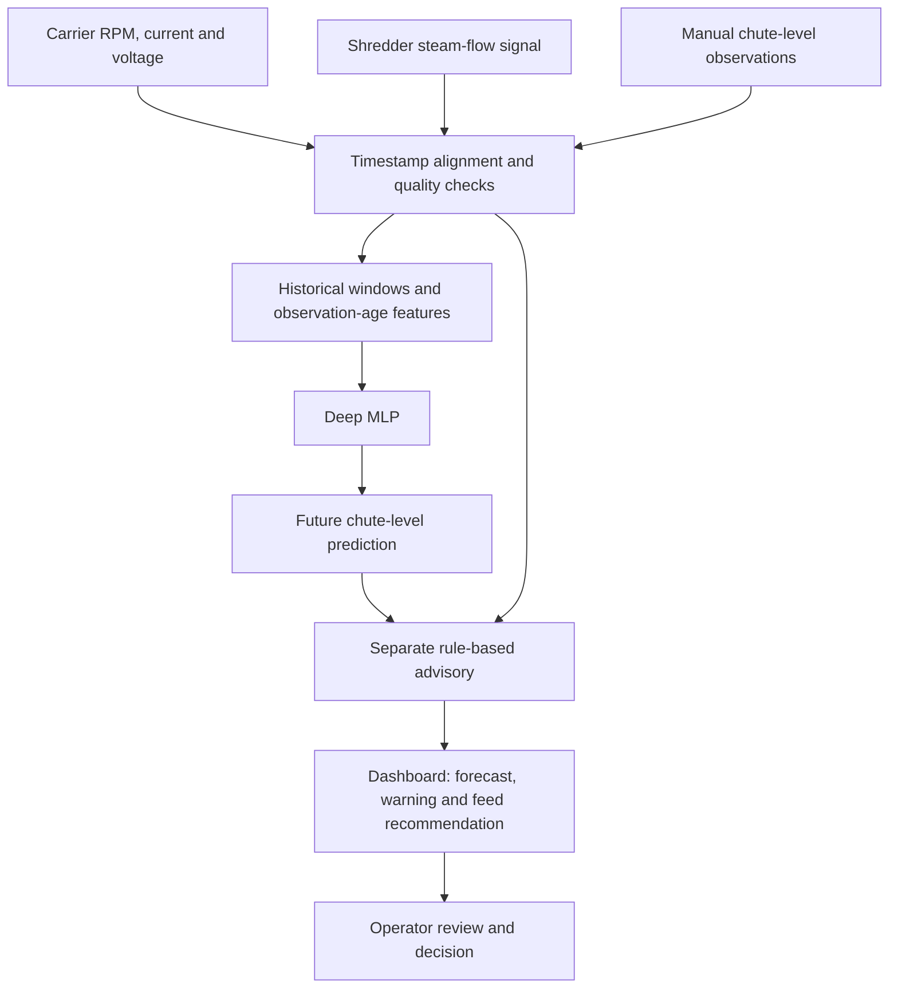

# Chute-Level Prediction and Carrier-Speed Advisory

Deep-learning-based chute-level forecasting and operator decision support for sugarcane feeding systems.

## Overview

Uneven sugarcane feeding can cause material to accumulate or fall below the required level in a mill feed chute. Operators need timely information to assess these changes and adjust feeding appropriately.

This project is designed to predict chute level from recent equipment signals and manual level observations. A compact deep multilayer perceptron (MLP) provides a short-term forecast, while a separate rule-based advisory translates that forecast into warnings and feed-speed recommendations for operator review.

The project connects time-series modeling, industrial process monitoring, and a clear operator interface.

## Objectives

- Forecast chute level ahead of time using recent operating history.
- Identify rising accumulation and low-level conditions.
- Present understandable feed-speed advice alongside the prediction.
- Account for observation freshness and data quality.
- Evaluate forecast quality and computational requirements against baseline methods.

## System Workflow



## Input Data

| Input group | Information |
| --- | --- |
| Auxiliary carrier | Motor RPM, current and voltage |
| Main carrier | Motor RPM, current and voltage |
| Cane carrier | Motor RPM, current and voltage |
| Shredder | Turbine steam-flow signal |
| Chute observations | Manually estimated level, timestamp, observation age and quality |
| Equipment context | Motor nameplate ratings and operating limits |

Manual chute-level observations are based on wall markings. Motor current provides a load-related signal; it does not directly measure material weight or throughput. Fixed nameplate ratings are equipment metadata rather than changing process measurements.

## Model Design

The forecasting approach uses a compact fully connected network:

```text
Historical input features
          |
     Dense: 64 + ReLU
          |
     Dense: 32 + ReLU
          |
     Dense: 16 + ReLU
          |
   Predicted chute level (%)
```

The initial design uses a 60-second history and a 30-second prediction horizon, with training-only feature scaling, Huber loss, AdamW optimization and validation-based early stopping. These settings can be refined through experiments.

## Operator Advisory

The operating band reported for the visited mill is **60–75%**, inclusive. This is a site-specific requirement.

| Forecast or input condition | Advisory logic |
| --- | --- |
| Within 60–75% | Hold the existing feed-speed suggestion |
| Above 75% | Raise a high-level warning and recommend a bounded feed reduction |
| Below 60% | Recommend a bounded increase only when operating conditions permit |
| Stale or invalid inputs, suspected restriction, or unknown equipment limits | Suppress numerical speed suggestions and request operator review |

Carrier-specific RPM recommendations depend on verified speed limits and coordination rules. The advisory supports operator decisions; it does not issue commands to factory drives. A high-level forecast indicates accumulation risk, not proof of blockage.

## Dashboard Design

The Python dashboard is designed to show:

- Latest chute-level observation and its freshness.
- Predicted future level and recent trends.
- Target operating band and warning status.
- Recommended feed action and carrier-speed suggestions where valid.
- Input-quality messages requiring operator attention.

## Evaluation

The evaluation design compares the history-based MLP with persistence, linear regression and a snapshot MLP. Separate feature comparisons examine the contribution of motor-current signals and observation-age information.

Measures include MAE and RMSE in level percentage points, warning precision and recall, false alarms, warning lead time and CPU inference latency. Complete operating episodes are separated before constructing training and test windows to reduce data leakage.

## Technology Stack

The technical design uses **Python, NumPy, pandas, PyTorch and scikit-learn**, with a local Python dashboard for visualization and operator interaction.

## Author

**Syed Affan Ali**  
Deep Learning coursework project — MS Artificial Intelligence  
NED University of Engineering and Technology, Karachi

[Portfolio](https://syedaffan-saffu.github.io/) · [GitHub](https://github.com/syedaffan-saffu)
